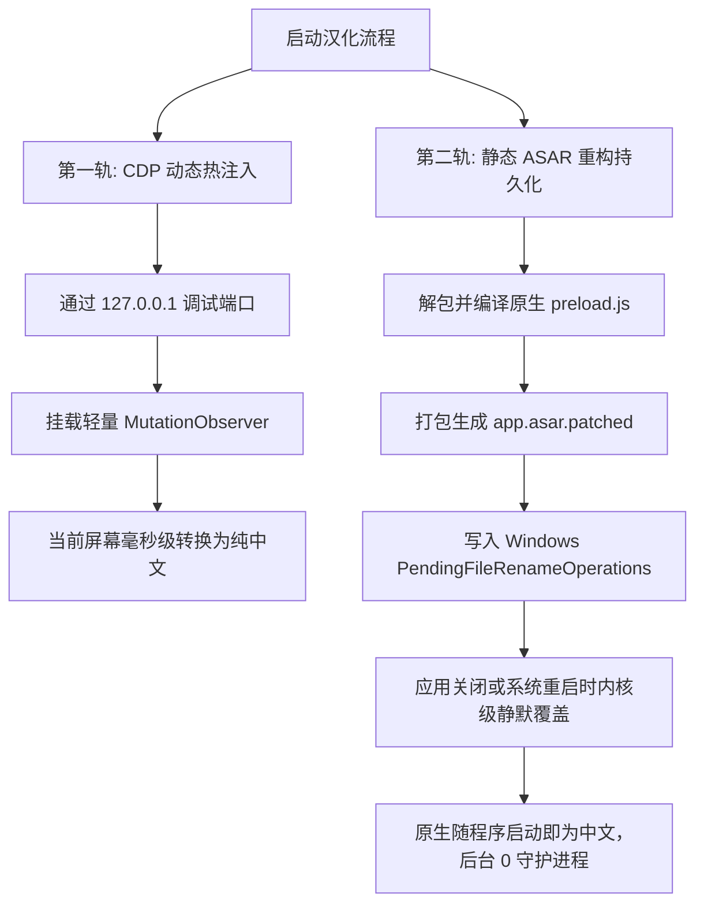

# Antigravity CN Toolkit 架构设计与底层机制

## 1. 免 TUN 模式出海原理
很多开发者在使用 Antigravity 时，习惯开启 TUN（虚拟网卡）模式。但 TUN 模式具有较强的侵入性，会直接修改系统路由表，容易导致公司内网穿透中断、局域网打印机失效或本地联机游戏掉线。

Antigravity 整体基于 Electron 构建，其网络请求流经两层：
1. **Chromium 渲染与主进程**
2. **伴随的 Node.js 工具子进程（CLI、MCP、插件等）**

本项目直接在 Windows 用户注册表 `HKCU\Environment` 注入标准代理变量：
- `HTTP_PROXY=http://127.0.0.1:10808`
- `HTTPS_PROXY=http://127.0.0.1:10808`
- `ALL_PROXY=socks5://127.0.0.1:10808`

Node.js 与 Chromium 在启动时均会自动读取该环境变量，从而使 Antigravity 整体及其内部发起的所有外部网络请求（模型交互、依赖下载、网页检索等）自动、平滑地走 10808 本地出海端口，实现“零侵入、免 TUN”出海。

---

## 2. 双轨制汉化模型 (Dual-Track Localization)

常规的汉化手段通常存在以下缺陷：
- **纯动态脚本（如 Tampermonkey / 外挂守护）**：需要后台常驻 VBS/BAT 或监听进程，极易被杀毒软件误报，关闭程序后后台可能残留无用任务。
- **纯静态替换 ASAR**：只能在下次启动时生效，当前正在使用的窗口无法立刻变中文，且官方小版本更新后容易直接被覆盖回退。

为此，本项目提出了**双轨制汉化模型**：

### 词典韧性增强机制
1. **精确词典优先**：487+ 条精校翻译项 O(1) 毫秒级命中；
2. **动态版本正则**：`^Version\s+([0-9\.\-a-zA-Z]+)$` 自动映射为 `版本 $1`，无论后续升级到何种小版本均可自动识别；
3. **前缀模糊匹配**：针对界面长句或被 CSS 截断带 `...` 的内置技能说明，按特征前缀自动命中完整中文。
