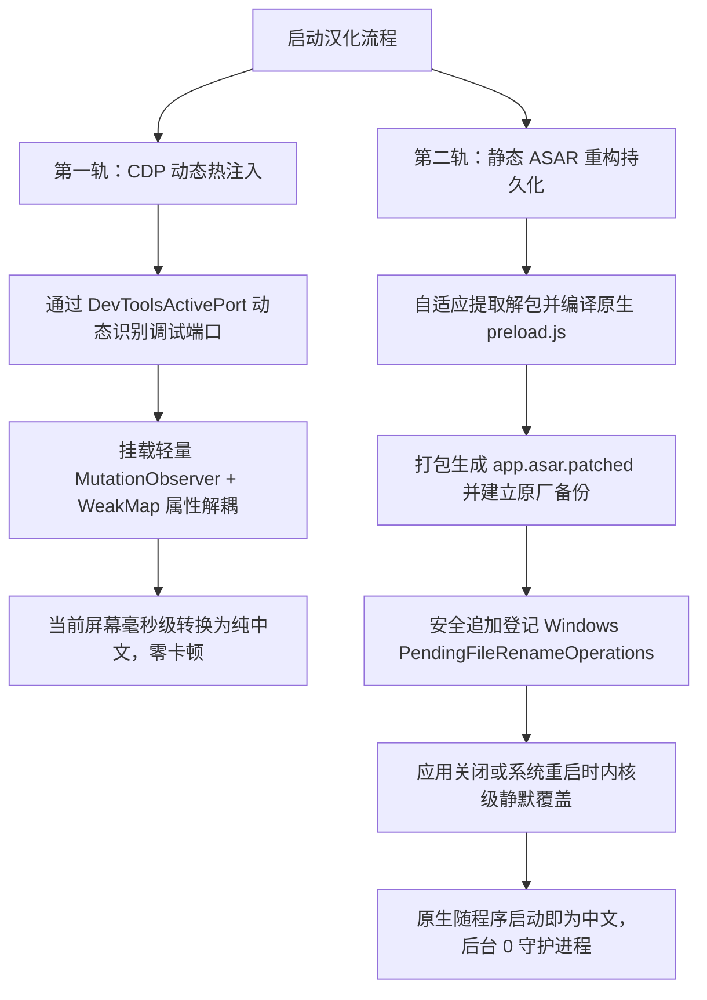

# Antigravity CN Toolkit 架构设计与底层机制

## 1. 免 TUN 模式出海原理
很多开发者在使用 Antigravity 时，习惯开启 TUN（虚拟网卡）模式。但 TUN 模式具有较强的侵入性，会直接修改系统路由表，容易导致公司内网穿透中断、局域网打印机失效或本地联机游戏掉线。

Antigravity 整体基于 Electron 构建，其网络请求流经两层：
1. **Chromium 渲染与主进程**
2. **伴随的 Node.js 工具子进程（CLI、MCP、插件等）**

本项目直接在 Windows 用户注册表 `HKCU\Environment` 注入标准代理变量：
- `HTTP_PROXY=http://127.0.0.1:10808`
- `HTTPS_PROXY=http://127.0.0.1:10808`
- `ALL_PROXY=socks5://127.0.0.1:10808`

Node.js 与 Chromium 在启动时均会自动读取该环境变量，从而使 Antigravity 整体及其内部发起的所有外部网络请求（模型交互、依赖下载、网页检索等）自动、平滑地走 10808 本地出海端口，实现“零侵入、免 TUN”出海。在配置前，脚本会前置探测 10808 端口监听与 Google 节点连通性，离线时安全跳过，防止用户断网。

---

## 2. 双轨制汉化模型 (Dual-Track Localization)

常规的汉化手段通常存在以下缺陷：
- **纯动态脚本（如 Tampermonkey / 外挂守护）**：需要后台常驻 VBS/BAT 或监听进程，极易被杀毒软件误报，关闭程序后后台可能残留无用任务。
- **纯静态替换 ASAR**：只能在下次启动时生效，当前正在使用的窗口无法立刻变中文，且官方小版本更新后容易直接被覆盖回退。

为此，本项目提出了 *双轨制汉化模型*：

### 词典韧性增强机制
1. **精准词典优先**：500+ 条高频精选词条 O(1) 毫秒级命中，杜绝吃文字与乱码映射；
2. **模型思考强度精准对照**：将推理模型思维链参数（Low / Medium / High）准确汉化为“轻量思考 / 平衡思考 / 深度思考”，杜绝将思考强度误译为“额度充裕/紧张”；
3. **动态版本正则**：`^Version\s+([0-9\.\-a-zA-Z]+)$` 自动映射为 `版本 $1`，无论后续升级到何种小版本均可自动识别；
4. **前缀模糊匹配**：针对界面长句或被 CSS 截断带 `...` 的内置技能说明，按特征前缀自动命中完整中文。

---

## 3. 自适应单真实源与防注入规范
- **杜绝硬编码**：全面使用 `os.homedir()`、`LOCALAPPDATA`、`APPDATA` 自适应定位，无论安装在任何盘符或路径均可正常工作；
- **命令行防注入**：所有 PowerShell 自动化操作均采用 Base64 UTF-16LE 编码传参，彻底杜绝路径中单双引号截断引发的脚本注入；
- **安全追加队列**：修改 `PendingFileRenameOperations` 时采取“读取 -> 过滤清理旧同名项 -> 追加”策略，绝不覆盖整值，保护系统其他软件的重启安装队列。
